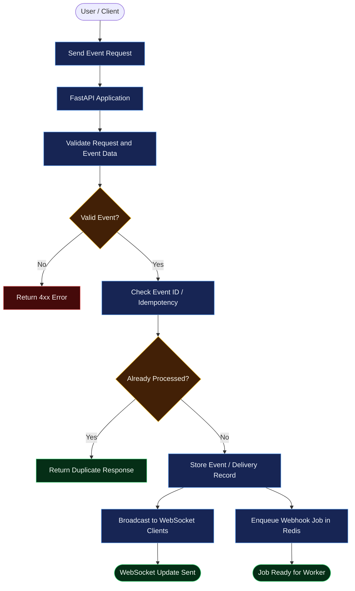
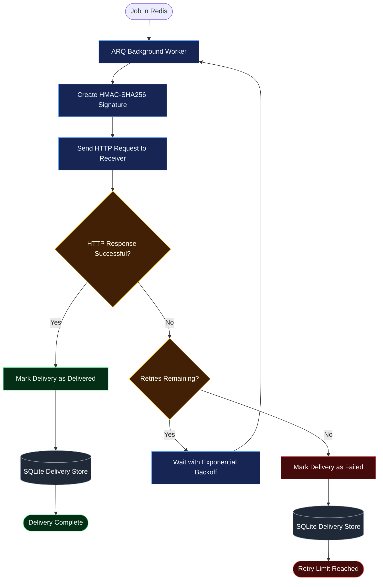
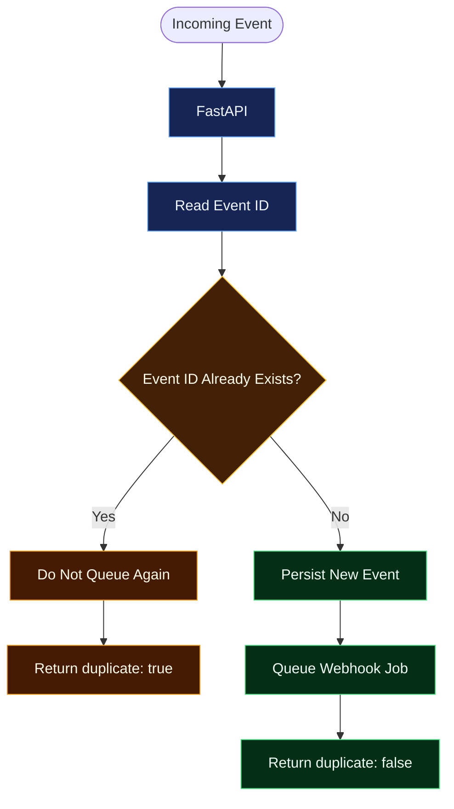

<div align="center">

# Real-Time Event Broadcaster & Webhook Delivery Engine

**Asynchronous event broadcasting and webhook delivery with FastAPI, WebSockets, Redis, and ARQ.**

Validate events, detect duplicates, broadcast to connected clients, and deliver signed webhooks in the background with retry handling.


</div>

---

## Table of Contents

- [Overview](#overview)
- [Features](#features)
- [Technology Stack](#technology-stack)
- [System Architecture](#system-architecture)
  - [Event Ingestion Flow](#1-event-ingestion-flow)
  - [Webhook Delivery and Retry Flow](#2-webhook-delivery-and-retry-flow)
  - [Duplicate Event Flow](#3-duplicate-event-flow)
- [How It Works](#how-it-works)
- [Repository Structure](#repository-structure)
- [Quick Start](#quick-start)
- [API Endpoints](#api-endpoints)
- [Example Event](#example-event)
- [Security](#security)
- [Idempotency and Retries](#idempotency-and-retries)
- [Testing](#testing)
- [Troubleshooting](#troubleshooting)
- [Production Considerations](#production-considerations)
- [Future Improvements](#future-improvements)
- [Contributing](#contributing)
- [License](#license)

---

## Overview

The **Real-Time Event Broadcaster & Webhook Delivery Engine** accepts events through a FastAPI endpoint and distributes them through two paths:

1. **Real-time:** broadcast events to connected WebSocket clients.
2. **Asynchronous:** enqueue webhook jobs in Redis and process them with an ARQ worker.

The worker signs outgoing payloads using HMAC-SHA256, sends HTTP requests to webhook receivers, retries eligible failures with exponential backoff, and records delivery outcomes in SQLite.

This project demonstrates asynchronous Python, event-driven backend design, background processing, webhook security, idempotency, and automated testing.

## Features

- FastAPI event API and request validation.
- Real-time broadcasting through WebSockets.
- Redis-backed background jobs processed by ARQ.
- HMAC-SHA256 signatures for webhook authenticity and payload integrity.
- Retry handling with exponential backoff.
- Duplicate event detection and receiver idempotency.
- SQLite delivery records and receiver attempt history.
- Webhook destination validation to reduce SSRF risk.
- Automated tests for events, receiver behavior, signing, and URL security.

## Technology Stack

| Technology | Responsibility |
|---|---|
| Python | Main programming language |
| FastAPI | HTTP API and receiver |
| WebSockets | Real-time event broadcasting |
| Redis | Background job queue backend |
| ARQ | Asynchronous worker |
| HTTPX | Async HTTP requests |
| Tenacity / retry logic | Retry handling and backoff |
| `hmac`, `hashlib` | HMAC-SHA256 signing and verification |
| SQLite + aiosqlite | Local persistence |
| pytest | Automated tests |
| Docker Compose | Local Redis service |

---

## System Architecture

The diagrams are split into smaller flows so the request path and retry loop stay readable in GitHub's Mermaid renderer.

### 1. Event Ingestion Flow



**What happens:** FastAPI validates the event and checks its ID. A duplicate receives a duplicate response. A new event is recorded, broadcast to WebSocket clients, and queued for webhook delivery.

### 2. Webhook Delivery and Retry Flow



**What happens:** The worker signs and sends the webhook. A successful response is recorded as delivered. Failed attempts are retried with backoff until they succeed or exhaust the configured retry limit.

### 3. Duplicate Event Flow



## How It Works

1. A client submits an event to the API.
2. FastAPI validates the request and checks the event ID.
3. A new event is stored and a webhook job is queued in Redis.
4. Connected WebSocket clients can receive the event in real time.
5. The ARQ worker signs the payload and sends it with HTTPX.
6. Success updates the delivery status to `delivered`.
7. Retryable failures are attempted again after a backoff delay.
8. Exhausted attempts are marked `failed`.

## Repository Structure

```text
realtime-webhook-engine/
├── app/
│   ├── __init__.py
│   ├── main.py                 # FastAPI application and event endpoints
│   ├── config.py               # Application configuration
│   ├── events.py               # Event handling and broadcasting
│   ├── websocket_manager.py    # Active WebSocket connections
│   ├── webhook_signing.py      # HMAC signing helpers
│   ├── webhook_security.py     # Destination URL validation
│   ├── worker.py               # ARQ worker and delivery logic
│   ├── receiver.py             # Local test receiver
│   └── delivery_store.py       # Delivery persistence
├── tests/
│   ├── __init__.py
│   ├── test_events.py
│   ├── test_receiver.py
│   ├── test_webhook_signing.py
│   └── test_webhook_security.py
├── data/                       # Local SQLite files (Git-ignored)
├── assets/                     # Optional README images/GIFs
├── .env                        # Local secrets (never commit)
├── .env.example                # Placeholder configuration
├── .gitignore
├── docker-compose.yml
├── requirements.txt
└── README.md
```

> Adjust this tree if the files in your repository differ.

## Quick Start

### Prerequisites

- Python 3.11+ (or the version supported by your dependencies)
- Git
- Docker Desktop with its engine running, or a separate Redis instance
- PowerShell on Windows, or a compatible terminal

### 1. Clone the Repository

```powershell
git clone <YOUR_GITHUB_REPOSITORY_URL>
cd realtime-webhook-engine
```

### 2. Create a Virtual Environment

```powershell
python -m venv venv
.\venv\Scripts\Activate.ps1
```

Install dependencies:

```powershell
python -m pip install --upgrade pip
pip install -r requirements.txt
python -m pip check
```

### 3. Configure Environment Variables

```powershell
Copy-Item .env.example .env
```

Open `.env` and fill in the values required by the configuration in your code. Keep real secrets in `.env`; `.env.example` should contain placeholders only. The exact variable names should match your project's `.env.example`.

### 4. Start Redis

```powershell
docker compose up -d redis
```

If the container name is `webhook-redis`, verify it with:

```powershell
docker exec -it webhook-redis redis-cli ping
```

Expected output:

```text
PONG
```

If the container has a different name, check `docker ps`.

### 5. Run the FastAPI Application

In terminal 1:

```powershell
python -m uvicorn app.main:app --reload --port 8000
```

Open the interactive API docs at [http://127.0.0.1:8000/docs](http://127.0.0.1:8000/docs).

### 6. Run the ARQ Worker

In terminal 2, activate the virtual environment and run:

```powershell
python -m arq app.worker.WorkerSettings
```

### 7. Run the Test Receiver

In terminal 3, activate the virtual environment and run:

```powershell
python -m uvicorn app.receiver:app --reload --port 9001
```

Keep Redis, the API, the worker, and the receiver running during an end-to-end test.

## API Endpoints

These endpoints are used by the local development/testing workflow. Check `/docs` for the exact request schema and any additional routes.

| Endpoint | Method | Purpose |
|---|---|---|
| `/events` | `POST` | Submit an event |
| `/docs` | `GET` | Interactive API documentation |
| `/received` | `GET` | Inspect events received by the test receiver |
| `/attempts` | `GET` | Inspect receiver delivery attempts |
| `/test/fail-next/1` | `POST` | Make the receiver fail the next request once, for retry testing |

`/test/fail-next/1` is a development helper and should not be exposed by a production receiver.

## Example Event

Use Swagger UI at `http://127.0.0.1:8000/docs` to inspect the actual schema for `POST /events`. The following is an illustrative payload only; adjust field names to match your Pydantic request model.

```json
{
  "event_id": "demo-event-001",
  "event_type": "webhook.demo",
  "payload": {
    "message": "Hello from the event engine"
  }
}
```

A successful request should be accepted by the API and, when a receiver is configured, queued for asynchronous delivery.

## Security

### HMAC-SHA256 Signing

The sender calculates a signature using a shared secret and the webhook payload. The receiver independently calculates the expected signature and verifies it.

- Store signing secrets in environment variables.
- Use `hmac.compare_digest` for signature comparisons.
- Sign and verify the exact same payload bytes.
- Use HTTPS for production webhook destinations.
- Never log secret keys or authorization headers.

### Webhook URL Validation

The application validates webhook destinations to reject unsafe URLs and reduce server-side request forgery (SSRF) risk. URL validation alone is not a complete SSRF defense: DNS can change between validation and connection. Production systems should also enforce outbound network controls or use a controlled egress proxy.

## Idempotency and Retries

Idempotency prevents the same event ID from being processed repeatedly. It is important when a client retries after a timeout because the receiver may have processed the first request even if the sender did not receive its response.

An example duplicate receiver response is:

```json
{
  "status": "already_processed",
  "event_id": "idempotency-manual-test-001",
  "duplicate": true
}
```

The exact response depends on the endpoint implementation.

A simplified retry example:

```text
Attempt 1 → HTTP 503
      ↓ backoff
Attempt 2 → HTTP 200
      ↓
Delivery marked as delivered
```

Retries provide at-least-once delivery attempts, not guaranteed exactly-once delivery. Receivers should therefore handle duplicate requests safely.

## Testing

Run the test suite:

```powershell
python -m pytest tests/ -v
```

Check dependency consistency:

```powershell
python -m pip check
```

The latest recorded local test run completed with **29 passed** and one non-blocking deprecation warning. Re-run tests after making changes; counts and warnings may change.

### Manual End-to-End Checks

1. Publish a new event and confirm successful delivery.
2. Configure the receiver to fail once and verify a later retry succeeds.
3. Submit the same event ID twice and verify duplicate recognition.
4. Confirm a valid HMAC signature is accepted.
5. Confirm a modified payload is rejected.
6. Confirm unsafe webhook destinations are rejected.

## Troubleshooting

| Problem | What to check |
|---|---|
| Redis connection error | Start Docker Desktop and run `docker compose up -d redis`. |
| Redis does not return `PONG` | Check `docker ps` and `docker logs webhook-redis`. |
| Delivery remains queued | Confirm Redis and the ARQ worker are running; inspect worker logs. |
| Receiver connection fails | Confirm the receiver is running on port `9001` and the URL matches its route. |
| API returns `422` | Compare the request body with the schema in `/docs`. |
| API returns `500` | Read the API terminal traceback and check database, configuration, and Redis connectivity. |
| PowerShell blocks `uvicorn.exe` | Run `python -m uvicorn app.main:app --reload --port 8000`. |
| Tests fail after dependency updates | Run `python -m pip check` and inspect the traceback. |

## Production Considerations

Before using this as a production service, consider:

- **Transactional outbox:** database persistence and Redis enqueueing can fail separately. An outbox or recovery mechanism can prevent silently lost jobs.
- **Atomic idempotency:** concurrent requests with the same ID must not both be accepted.
- **Retry policy:** define retryable status codes, timeouts, maximum attempts, jitter, and maximum delay.
- **Observability:** add structured logs, metrics, correlation IDs, and failure alerts.
- **SSRF defense:** combine URL validation with network-level egress controls.
- **Authentication:** protect event publishing and management endpoints before public deployment.
- **Resource limits:** cap payload sizes, WebSocket connections, and concurrent outbound requests.
- **Persistence:** evaluate whether SQLite meets your concurrency and availability requirements.
- **Secret rotation:** define how signing keys are rotated and how receivers handle key changes.

## Future Improvements

- Transactional outbox for reliable queue publication.
- Delivery history and retry controls through a management API.
- Structured JSON logs and metrics.
- Configurable per-webhook retry policies.
- Docker Compose services for API, worker, receiver, and Redis.
- GitHub Actions to run tests on pull requests.
- Load tests for many WebSocket clients and concurrent failed webhook requests.

## Contributing

Contributions and suggestions are welcome.

1. Fork the repository.
2. Create a branch: `git checkout -b feat/your-feature`.
3. Add or update tests.
4. Run `python -m pytest tests/ -v`.
5. Commit with a clear message, such as `feat: add delivery metrics`.
6. Open a pull request describing the change and test results.

Never include secrets, personal data, or production webhook payloads in commits or test fixtures.

## License

Choose a license before publishing the repository. If you intend to use the MIT License, add a `LICENSE` file containing the official MIT License text.
